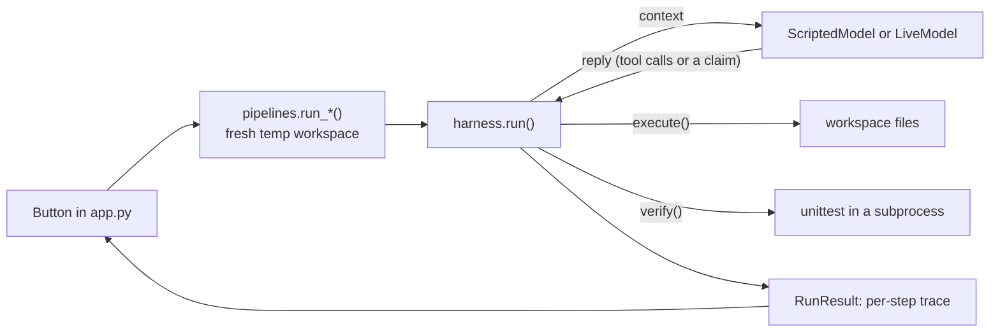

# Harness Engineering Explorer

An interactive Streamlit app for **seeing** how an agent harness wraps a language model: what the
model is shown on each call, which tools it may ask for, how its work is checked against real
evidence, how its history is compacted, and when the loop stops.

It's a companion to the *Harness Engineering* example in
[Generative AI Design Patterns](https://github.com/lakshmanok/generative-ai-design-patterns)
(`examples/19_harness_engineering`). The harness code in `harness_lab/harness.py` keeps the
notebook's function names and logic, so you can read the two side by side.

> **New to this?** Read [docs/how-harness-engineering-works.md](docs/how-harness-engineering-works.md)
> first. It explains every idea in plain language, with diagrams and real traces from this app.
> Terms are defined in [GLOSSARY.md](GLOSSARY.md).

---

## Quick start

Requirements: [uv](https://docs.astral.sh/uv/). No GPU, no model download, and no API key needed.

```bash
uv sync                          # installs Python 3.12 + dependencies into .venv
uv run streamlit run app.py      # opens http://localhost:8501
```

Run the tests:

```bash
uv run pytest
```

### Live mode (optional)

Tab ⑤ can also drive the loop with a real OpenAI model, as the notebook does. Provide a key in any
of these ways (checked in this order):

1. the `OPENAI_API_KEY` environment variable;
2. a `.env` file in this folder containing `OPENAI_API_KEY=sk-...` (it's git-ignored);
3. the password box in the app's sidebar (kept for the browser session only).

If you already use the book repo's `examples/keys.env`, copy the key from there. The app doesn't
read files outside this folder.

| Setting | How | Default |
|---|---|---|
| Live model | Sidebar text box | `gpt-4o-mini` (any chat model with tool calling) |
| Step limit, budget | Tab ⑤ controls | 10 steps, 2,000 characters (the notebook's values) |

---

## How the app works

There are five tabs, meant to be followed in order. Tabs ①–④ each open up one part of the harness
and need **no model at all**: they're instant, free, and give the same result every time. Tab ⑤
puts everything together.

### ① Context assembly

**What it shows:** the exact list of messages the model receives on each call, rebuilt from
scratch every step by `assemble()`.

**You provide:** a step number, and optionally an edited skill (or no skill).

**What you see:** the context for that step from a recorded run of scenario 2. It's broken
down into system prompt + skill, task, and history, with sizes, a 🆕 marker on messages added
since the previous step, and the raw JSON.

### ② Tool contract

**What it shows:** how the harness turns a model's tool request into an action, and why errors are
returned as text instead of raised.

**You provide:** a tool name and raw JSON arguments (presets: good call, unknown tool, malformed
JSON, missing argument, path outside the workspace).

**What happens when you click *Execute*:** the call is sent through the real `execute()` against a
workspace kept for your session. You see the tool result, which branch of `execute()` handled it,
the `tool` message that would go back into the history, and the workspace files.

### ③ Verification

**What it shows:** the model's claim ("done!") next to the evidence (the test run's exit code).

**You provide:** a spec (notebook spec, + `test_unicode`, or + an impossible test) and a candidate
`slugify.py` (correct, naive, syntax error, infinite loop, missing file…). Both can be edited.

**What happens when you click *Claim done & verify*:** the real `run_tests()` runs the spec in a
subprocess (10 s timeout). You see the exit code, which tests failed, the full stderr, and the
`TEST_FAILURE` message that would go back to the model.

### ④ Compaction

**What it shows:** when the history outgrows the budget and what replaces it.

**You provide:** a budget (characters).

**What you see:** a chart of history size per step (from scenario 6, recorded with compaction off)
against your budget, the step where compaction would fire, and the history before vs the one-message
summary after. With a key, you can have a live model write the summary.

### ⑤ Agent loop

**What it shows:** the full `run()` loop: budget check → compact → assemble → model → execute or
verify → repeat.

**You provide:** **Scripted** mode (pick one of 8 scenarios) or **Live** mode (pick a spec), a step
limit and a budget.

| # | Scripted scenario | Harness path it makes fire |
|---|---|---|
| 1 | Happy path | write → claim → verified |
| 2 | Fix after a test failure | false claim → `TEST_FAILURE` → fix |
| 3 | Unknown tool | `error: no such tool` returned as text |
| 4 | Malformed arguments | JSON error and missing argument returned as text |
| 5 | Claims done too early | claim with no file → import error |
| 6 | Compaction | history over budget → summary |
| 7 | Never passes | impossible spec → step limit |
| 8 | Two tool calls in one reply | each call answered by `tool_call_id` |

**What you see:** a live log while it runs, then the outcome, a one-row-per-step table, and a step
slider showing the loop diagram (with this step's path highlighted), any compaction, the context
sent, the model's reply, tool results or test evidence, and the workspace files at that step.

---

## Project structure

```
app.py                      Streamlit UI (5 tabs). The only file that knows about Streamlit.
harness_lab/
  harness.py                The notebook's harness: assemble, write_file, run_tests, TOOL_SCHEMA,
                            execute, compact, verify, run. Plus the trace records.
  models.py                 ScriptedModel and LiveModel (same return type), API-key lookup.
  scenarios.py              The 8 named scripts for the ScriptedModel.
  specs.py                  The spec variants and candidate implementations.
  pipelines.py              One function per tab: fresh workspace + harness call.
tests/                      Unit and end-to-end tests (scripted models, real subprocess tests).
docs/
  how-harness-engineering-works.md   Beginner's guide with diagrams.
  adr/                      Architecture decision records.
GLOSSARY.md                 The project's vocabulary.
```

### How a click flows through the code



The harness never knows which model it's talking to. Both return OpenAI's
`ChatCompletionMessage`, so the tests can drive the real loop with scripted models and check every
path exactly.

---

## Differences from the reference notebook

See section 8 of the [guide](docs/how-harness-engineering-works.md#8-where-the-app-differs-from-the-notebook).
In short: the model and workspace are parameters, every run gets a fresh temp directory, the test
subprocess has a timeout and runs with `python -B` (avoiding a stale-bytecode bug), `write_file`
stays inside the workspace, and `run()` returns a trace instead of printing.
