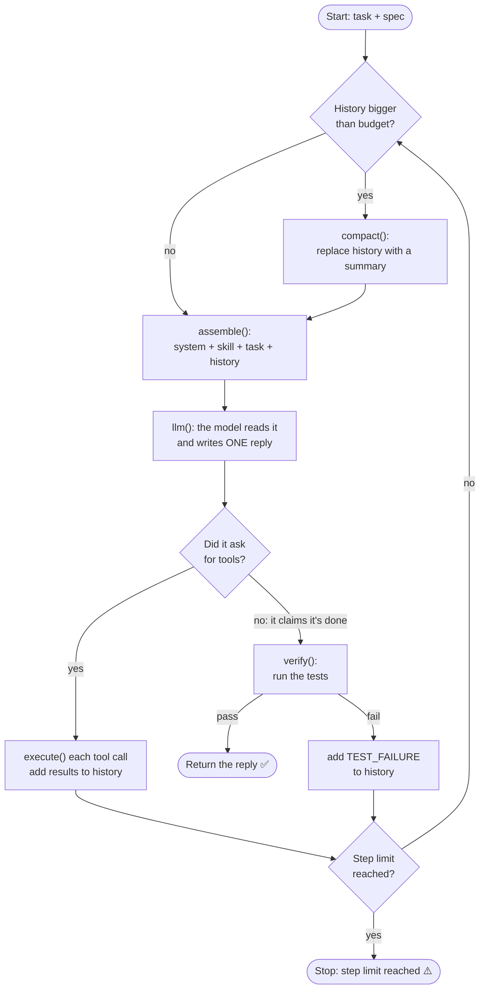
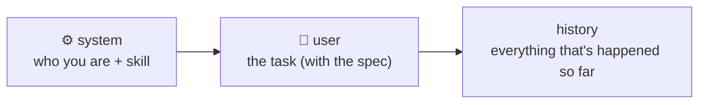
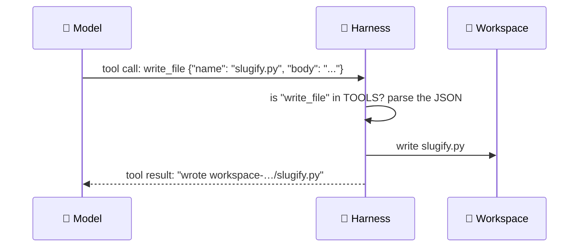

# How Harness Engineering Works: a Beginner's Guide

This guide explains **harness engineering** from the ground up and walks through every part of the
Harness Engineering Explorer app. You don't need a machine-learning background. You only need to
be able to read a little Python. If a word is unfamiliar, check the [glossary](../GLOSSARY.md).

> **The 30-second version.** A language model can only do one thing: read some text and write a
> reply. It can't open files, run tests, or even remember what it said a minute ago. The
> **harness** is the ordinary code wrapped around the model that does everything else. It decides
> what the model gets to read, carries out the actions the model asks for, checks whether the work
> really succeeded, keeps the conversation from getting too long, and decides when to stop.
> **The model reasons. The harness does everything else.**

**Contents**

1. [The big picture: model vs harness](#1-the-big-picture-model-vs-harness)
2. [The running example: slugify](#2-the-running-example-slugify)
3. [Context assembly (tab ①)](#3-context-assembly-tab-)
4. [The tool contract (tab ②)](#4-the-tool-contract-tab-)
5. [Verification (tab ③)](#5-verification-tab-)
6. [Compaction (tab ④)](#6-compaction-tab-)
7. [The agent loop (tab ⑤)](#7-the-agent-loop-tab-)
8. [Where the app differs from the notebook](#8-where-the-app-differs-from-the-notebook)
9. [What a production harness adds](#9-what-a-production-harness-adds)
10. [Appendix A: one complete run, step by step](#appendix-a-one-complete-run-step-by-step)

> **About the examples in this guide.** Every trace below was produced by the app itself, running
> the real harness code: real files written, real tests run in a subprocess. The *model* in these
> traces is the app's **Scripted** model, which replays a fixed script (see
> [section 7.4](#74-scripted-vs-live)). Workspace names like `workspace-7qizc7o4` are random and
> will differ on your machine.

---

## 1. The big picture: model vs harness

### 1.1 What the model can and can't do

Think of the model as a brilliant expert locked in a room with no windows, no computer, and no
memory. You communicate by sliding a stack of paper under the door. The expert reads the whole
stack, writes one note, and slides it back. Then they forget everything.

That is exactly how a model API call works:

- **It reads.** You send a list of messages, and the model reads all of them.
- **It writes one reply.** The reply is either plain text ("I'm done, here's what I did") or a
  **request** to use a tool ("please write this file for me").
- **It forgets.** The next call starts from nothing. The model only knows what's in the messages
  you send *this time*. This is what "**stateless**" means.

So if the expert asks you to write a file, *you* have to walk over and write it. If you want them
to know what happened last time, *you* have to include it in the next stack of paper. If they say
"done!", *you* have to check.

### 1.2 The harness is "you"

The **harness** is the code playing your role. In this app (and the notebook it's based on), the
harness has five jobs:

| Job | What it means | Function | App tab |
|---|---|---|---|
| **Assemble the context** | Build the stack of paper the model reads on each call | `assemble()` | ① |
| **Act in the world** | Do what the model asks (write files) and report back | `execute()`, `write_file()` | ② |
| **Verify** | Check the work with evidence (run the tests), not trust | `verify()`, `run_tests()` | ③ |
| **Organize** | When the stack gets too thick, replace it with a summary | `compact()` | ④ |
| **Decide when to stop** | Stop when the tests pass or when we've tried enough times | `run()` | ⑤ |

### 1.3 The loop at a glance



One trip around this loop is a **step**, and each step calls the model **exactly once**. The rest
of this guide takes the boxes one at a time.

---

## 2. The running example: slugify

Everything in the app uses the same small task from the notebook: write a Python function called
`slugify`.

A **slug** is the URL-friendly version of a title. For example, a blog post called
"Hello, World!" might live at `example.com/hello-world`. To make one, you lowercase the text, remove
punctuation, and join the words with single hyphens.

### 2.1 The spec

The harness doesn't describe the task in words alone. It gives the model a **test suite**. This
is the **spec**, the exact definition of "done":

```python
import unittest
from slugify import slugify


class TestSlugify(unittest.TestCase):
    def test_basic(self):
        self.assertEqual(slugify("Hello World"), "hello-world")

    def test_punctuation(self):
        self.assertEqual(slugify("Hello, World!"), "hello-world")

    def test_collapses_space(self):
        self.assertEqual(slugify("  Hello   World  "), "hello-world")
```

In plain words:

| Test | Input | Expected | What it checks |
|---|---|---|---|
| `test_basic` | `"Hello World"` | `"hello-world"` | lowercase, and a space becomes a hyphen |
| `test_punctuation` | `"Hello, World!"` | `"hello-world"` | the comma and `!` are removed |
| `test_collapses_space` | `"  Hello   World  "` | `"hello-world"` | spaces at the ends vanish; three spaces in a row become **one** hyphen |

A correct answer is one line of regular expression:

```python
import re


def slugify(text: str) -> str:
    return re.sub(r"[^a-z0-9]+", "-", text.lower()).strip("-")
```

It replaces every run of characters that aren't lowercase letters or digits with a single `-`,
then trims hyphens from both ends.

### 2.2 Why a test suite and not just a description?

Because the harness can **run** a test suite. A description like "make a URL slug" leaves room
for argument. A test either passes or it doesn't. This idea comes back in
[section 5](#5-verification-tab-): the harness never asks the model whether its code works. It
runs the tests and looks at the result.

### 2.3 The task message

The notebook wraps the spec in a single sentence, and that becomes the **task**:

```text
Implement slugify(text) in slugify.py so this test suite passes:

import unittest
from slugify import slugify
...
```

At the start of every run, the harness creates an empty **workspace** (a scratch directory) and
puts the spec into it as `test_slugify.py`. Every other file that appears there was written by the
model, through the harness.

---

## 3. Context assembly (tab ①)

### 3.1 The idea

The **context** is the full list of messages the model reads on one call. Because the model is
stateless, **the harness rebuilds the context from scratch on every single step**. Nothing carries
over by itself. If something isn't in the list, the model doesn't know it.

The context always has the same shape:



### 3.2 The code, line by line

```python
SKILLS = {"python": "Write plain functions. No classes. Type-annotate."}

def assemble(task, history):
    system = "You write Python to satisfy the given test."
    return [{"role": "system", "content": f"{system}\n{SKILLS['python']}"},
            {"role": "user", "content": task}] + history
```

- **`system`** is the *system prompt*, the standing instruction about the model's role.
- **`SKILLS['python']`** is a **skill**: a house rule the model would otherwise have to guess.
  Your team might prefer plain functions over classes, but the model can't know that unless you
  tell it. The notebook has one skill. A real harness keeps many and picks the ones that fit the
  task.
- **`task`** is the user message from [section 2.3](#23-the-task-message).
- **`history`** is the list of everything that has happened in this run: the model's previous
  replies, the results of tools it used, and any test failures. The harness owns this list and
  adds to it as the run goes on.

Each message has a **`role`**:

| Role | Who "said" it | Icon in the app |
|---|---|---|
| `system` | The harness: standing instructions | ⚙️ |
| `user` | The harness, on behalf of the person: the task, and test failures | 🧑 |
| `assistant` | The model: its replies, including tool requests | 🤖 |
| `tool` | The harness: the result of a tool the model asked for | 🔧 |

### 3.3 A real example

Here's the context the model received on **step 2** of the *happy path* scenario. On step 1 the
model asked to write `slugify.py`, and the harness did it. Step 2's context contains all of that:

```json
[
 {"role": "system",
  "content": "You write Python to satisfy the given test.\nWrite plain functions. No classes. Type-annotate."},
 {"role": "user",
  "content": "Implement slugify(text) in slugify.py so this test suite passes:\n\nimport unittest\n..."},
 {"role": "assistant",
  "tool_calls": [{"id": "call_1", "type": "function",
                  "function": {"name": "write_file",
                               "arguments": "{\"name\": \"slugify.py\", \"body\": \"import re\\n\\n\\ndef slugify(text: str) -> str:\\n    return re.sub(...)\\n\"}"}}]},
 {"role": "tool", "tool_call_id": "call_1",
  "content": "wrote workspace-dl26v3hf/slugify.py"}
]
```

The first two messages are the same on every step. Messages 3 and 4 are the **history**: the
model's own previous request, and the harness's answer to it. Without them, the model on step 2
would have no idea that it already wrote the file.

### 3.4 How the context grows

From the recorded run of scenario 2 (*Fix after a test failure*):

| Step | Messages in the context | History size (characters) |
|---|---|---|
| 1 | 2 (system + task) | 0 |
| 2 | 4 | 436 |
| 3 | 6 | 1,260 |
| 4 | 8 | 1,656 |

Every step resends **everything**: the system prompt, the task, and the whole history. That's
why the history needs a size limit ([section 6](#6-compaction-tab-)).

### 3.5 What to try in tab ①

1. **Move the step slider.** The 🆕 marker shows which messages were added since the previous
   step. The first two messages never change.
2. **Edit the skill text** (for example, "Use only the standard library. Add a docstring."). The
   system message changes immediately. That's context injection: the harness alone decides what
   the model is told.
3. **Untick "Inject the skill".** The system prompt shrinks to one sentence. The model would no
   longer know your house rules.
4. Open **Raw JSON sent to the API** to see exactly what goes over the wire.

> **Key takeaway:** the model knows only what's in the context, and the harness builds the
> context. Most of the model's "intelligence about your project" is really the harness choosing
> what to show it.

---

## 4. The tool contract (tab ②)

### 4.1 The idea

The model can't touch your computer. When it wants something done, it writes a **tool call**: a
structured request that names a tool and gives the arguments as JSON text. The harness reads the
request, decides whether to honour it, does the work, and replies with a **tool result**.



### 4.2 Two halves that must stay in step

The **tool contract** has two halves:

```python
TOOLS = {"write_file": write_file}          # what the harness will run

TOOL_SCHEMA = [{                            # what the model may request
    "type": "function",
    "function": {
        "name": "write_file",
        "description": "Write a file into the workspace, overwriting it.",
        "parameters": {
            "type": "object",
            "properties": {
                "name": {"type": "string", "description": "File name in the workspace."},
                "body": {"type": "string", "description": "Full contents of the file."},
            },
            "required": ["name", "body"],
        },
    },
}]
```

- **`TOOL_SCHEMA`** is sent to the model with every call. It's the "menu": the tools that exist,
  what they do, and what arguments they take. The model reads the descriptions to decide what to
  ask for.
- **`TOOLS`** is the harness's own lookup table: tool name → the Python function it will actually
  run.

They must match. If the schema advertises a tool that isn't in `TOOLS`, the model will ask for
something the harness can't do. If `TOOLS` has a function that isn't in the schema, the model will
never know it exists.

> **Note:** the notebook defines `run_tests()` but does **not** offer it as a tool. The model can't
> run the tests itself. Only the harness runs them, during verification. That's deliberate: the
> referee shouldn't be one of the players.

### 4.3 `execute()`, line by line

```python
def execute(call):
    fn = TOOLS.get(call.function.name)      # a permission check would go here
    if fn is None:
        return f"error: no such tool {call.function.name}"
    try:
        return fn(**json.loads(call.function.arguments))  # a real harness
    except Exception as exc:                              # sandboxes this
        return f"error: {exc}"              # the model sees this and can retry
```

1. **Look up the name.** `TOOLS.get(...)` returns the function, or `None` if the harness doesn't
   have a tool by that name.
2. **Unknown name → error text.** Nothing is run.
3. **Parse the arguments.** The model sends arguments as a JSON *string*. `json.loads` turns it
   into a Python dict, and `**` passes the dict's keys as keyword arguments, so
   `{"name": "a.py", "body": "x"}` becomes `write_file(name="a.py", body="x")`.
4. **Any exception → error text.** Broken JSON, a missing argument, a disk error: all of them are
   caught and turned into a string.

### 4.4 The most important line: errors are *returned*, not raised

This is the key design choice. Here is what each kind of tool call produces, taken from the app:

| The model sent | `execute()` returned | What happened |
|---|---|---|
| `write_file` with valid arguments | `wrote workspace-…/slugify.py` | The tool ran |
| `run_shell` (not a real tool) | `error: no such tool run_shell` | Unknown name; nothing ran |
| `write_file` with JSON cut off mid-string | `error: Unterminated string starting at: line 1 column 32 (char 31)` | `json.loads` raised; caught |
| `write_file` with only `name` | `error: write_file() missing 1 required positional argument: 'body'` | Python raised `TypeError`; caught |
| `write_file` with `name="../escape.py"` | `error: '../escape.py' is outside the workspace` | App addition (section 8); caught |

Why does this matter? Suppose `execute()` let the exception escape. The first time the model
sent bad JSON, the whole program would crash, and the run would be over. Returning the error as
text means it goes into the history as a `tool` message. On the next step the model **reads its
own mistake** and can fix it. Scenarios 3 and 4 in tab ⑤ show exactly that: the model sends a bad
call, reads the error, and sends a good one.

### 4.5 Answering every call, by id

Every tool call carries an `id` (like `call_1`). The harness's answer must carry the same id as
`tool_call_id`:

```json
{"role": "tool", "tool_call_id": "call_1", "content": "wrote workspace-…/slugify.py"}
```

A model can ask for **several** tools in one reply, and each one needs its own answer. Scenario
8 (*Two tool calls in one reply*) shows this: one reply asks for `slugify.py` (`call_a`) and
`NOTES.md` (`call_b`), and the harness answers both, in order, each with its own id. The API
rejects the next request if any call is left unanswered.

### 4.6 What to try in tab ②

1. Click through the five presets and press **Execute** for each. Watch "What happened inside
   `execute()`" change.
2. After **Good call**, look at the workspace: `slugify.py` is there.
3. Invent your own tool name or break the JSON in a new way. You can't make `execute()` crash.
4. Notice the message under the result: that's what goes into the history for the model to read.

> **Key takeaway:** the model only *asks*; the harness decides and acts. Errors become text the
> model can learn from, so a bad call costs one step instead of the whole run.

---

## 5. Verification (tab ③)

### 5.1 The idea: a claim is not evidence

When the model replies with plain text and no tool call, it is saying "I'm finished." That's a
**claim**. Models are often confidently wrong: the reply sounds exactly the same whether the code
works or not.

So the harness doesn't take the model's word for it. It runs the spec and looks at the result.
That result is the **evidence**.

> The model saying "done" is a claim; the exit code of the test run is the fact that settles it.

### 5.2 The code

```python
def run_tests():
    proc = subprocess.run(
        [sys.executable, "-m", "unittest", "discover",
         "-s", str(WORKSPACE), "-t", str(WORKSPACE)],
        capture_output=True, text=True)
    return proc.returncode, proc.stderr.strip()


def verify():
    code, output = run_tests()
    return code == 0, output
```

- **`subprocess.run`** starts a **separate Python process** that runs the tests. If the model's
  code crashes, the crash happens over there, not inside the harness.
- **`unittest discover -s WORKSPACE`** finds every `test_*.py` file in the workspace and runs it.
- **`returncode`** is the *exit code*: `0` means every test passed, anything else means something
  failed. This single number is the verdict.
- **`stderr`** is where `unittest` prints its report. The harness keeps it because it explains
  *why* something failed.

### 5.3 What evidence looks like

**A failure.** In scenario 2, the model's first attempt removed punctuation but forgot to
collapse runs of spaces. It claimed "I've implemented slugify in slugify.py. It should pass all
the tests." The evidence said otherwise:

```text
.F.
======================================================================
FAIL: test_collapses_space (test_slugify.TestSlugify.test_collapses_space)
----------------------------------------------------------------------
Traceback (most recent call last):
  File ".../test_slugify.py", line 13, in test_collapses_space
    self.assertEqual(slugify("  Hello   World  "), "hello-world")
AssertionError: 'hello---world' != 'hello-world'
- hello---world
?      --
+ hello-world

----------------------------------------------------------------------
Ran 3 tests in 0.001s

FAILED (failures=1)
```

How to read it: `.F.` means test 1 passed (`.`), test 2 failed (`F`), test 3 passed. The model's
function turned three spaces into three hyphens (`hello---world`).

**Nothing written at all.** In scenario 5 the model pasted code into its reply ("All tests
pass.") without calling `write_file`. Nothing was on disk, so the tests couldn't even import it:

```text
ERROR: test_slugify (unittest.loader._FailedTest.test_slugify)
ImportError: Failed to import test module: test_slugify
...
ModuleNotFoundError: No module named 'slugify'
```

This is the clearest example of claim vs evidence: the reply looked complete, but nothing existed.

### 5.4 What happens after a failure

The evidence goes back into the history so the model can fix the problem on the next step:

```python
history.append({"role": "user", "content": f"TEST_FAILURE {evidence}"})
```

Why a **`user`** message and not a `tool` message? A `tool` message has to answer a specific tool
call (by `tool_call_id`). The model's "I'm done" reply had no tool call, so there's nothing for a
`tool` message to answer. The harness speaks up as the user instead: "here's what actually
happened."

### 5.5 What to try in tab ③

1. **Correct (regex)** with the notebook spec: exit code `0`, PASS.
2. **Naive (lower + replace spaces)**: `test_punctuation` and `test_collapses_space` fail.
3. **Nothing written (file missing)**: an import error, the "premature claim" case.
4. **Infinite loop**: the run is killed after 10 seconds (`TIMEOUT: ...`). Without a timeout, one
   bad `while True` from the model would hang the harness forever. (The notebook has no timeout;
   the app adds one.)
5. Switch the spec to **+ test_unicode (stricter)**. The *correct* regex version now **fails**
   (`"Café Déjà Vu"` should become `"cafe-deja-vu"`, but the regex drops the accented letters
   entirely). **Correct + handles accents** passes. Same code, different spec, different verdict:
   the spec defines "done".
6. Edit the spec or candidate yourself. Add a test, break the code, and see how the evidence
   changes.

> **Key takeaway:** the harness accepts work only when the tests pass. The model's confidence plays
> no part in the decision.

---

## 6. Compaction (tab ④)

### 6.1 The problem: the history only grows

Every step adds messages to the history (a reply, tool results, maybe a test failure), and every
step resends the **whole** history. Left alone, this causes three problems:

- **Models have a maximum context size.** Past it, the API refuses the request.
- **Cost and speed.** You pay for, and wait for, every character on every call.
- **Distraction.** Long histories full of old failed attempts can confuse the model.

### 6.2 The solution: replace the history with a summary

When the history gets bigger than a **budget**, the harness asks the model to summarize it, then
throws the old history away and keeps only the summary.

```python
def compact(history):
    prompt = ("Summarize for a fresh context: the current objective, the "
              "approaches already ruled out and why, and the paths of files "
              "already written to disk.")
    reply = llm(history + [{"role": "user", "content": prompt}])  # no tools:
    return [{"role": "assistant", "content": reply.content}]      # summarize
```

Three details:

1. **The prompt says exactly what to keep**: the objective, the dead ends *and why* (so the model
   doesn't try them again), and the file paths.
2. **The call has no tools.** `llm(...)` is called without `TOOL_SCHEMA`, so the model *can't* act
   here. It can only write a summary. That's why the notebook made `tools` optional in `llm()`.
3. **The result is a one-message history.** Everything else is gone.

### 6.3 When it fires

In the loop, the check happens at the **start** of each step, before the model is called:

```python
size = sum(len(json.dumps(m)) for m in history)   # chars, not tokens
if size > budget:
    history = compact(history)
```

The size is measured in **characters** of JSON, not tokens. Real APIs count tokens (roughly 4
characters of English each), but characters are simple and good enough for teaching. The default
budget is **2,000 characters** (about 500 tokens), deliberately tiny so you can watch compaction
happen. Real harnesses use budgets hundreds of times larger.

### 6.4 A real example

Scenario 6 (*Compaction*) has a model that writes long, wordy attempts. The history grows like
this:

| Step | History size at the start | What happens |
|---|---|---|
| 1 | 0 | writes attempt 1 |
| 2 | 550 | claims done → FAIL |
| 3 | 1,991 | writes attempt 2 (just under the budget) |
| 4 | **2,797** | **over 2,000 → compaction: 2,797 → 470 chars**, then claims done → FAIL |
| 5 | 1,344 | writes attempt 3 |
| 6 | 1,740 | claims done → PASS ✅ |

The summary that replaced six messages:

> Objective: implement slugify(text) in slugify.py so test_slugify.py passes (lowercase,
> punctuation removed, runs of spaces become one hyphen, no hyphens at the ends).
> Ruled out: (1) lower() + replace(' ', '-') keeps punctuation and turns runs of spaces into
> several hyphens. (2) Dropping punctuation then replacing spaces still fails
> test_collapses_space.
> Files on disk: slugify.py (approach 2, failing), test_slugify.py (the spec).

After compaction, the context on step 4 is just **three** messages: system, task, and this summary.

### 6.5 What's kept and what's lost

| Kept in the summary | Lost |
|---|---|
| The goal | The exact code of old attempts |
| What was tried and *why* it failed | The full test output |
| Which files are on disk | The exact wording of every message |

Losing the old code is fine because **the files are still on disk**. Compaction shrinks the
conversation, not the workspace. The current `slugify.py` is still there, and the next test run
produces fresh evidence.

### 6.6 What to try in tab ④

1. **Drag the budget slider.** The chart's horizontal line moves, and the app tells you at which
   step compaction would fire.
2. Look at **Before vs After**: many messages and thousands of characters become one short message.
3. If you've added an OpenAI key, click **Write the summary with the live model** to see what a
   real model keeps.
4. In tab ⑤, run scenario 7 (*Never passes*): compaction fires **twice**, at steps 5 and 9.
   Long runs compact again and again.

> **Key takeaway:** compaction trades detail for room. A good summary keeps what the model needs to
> continue (the goal, the dead ends, where things are) and drops what the disk already remembers.

---

## 7. The agent loop (tab ⑤)

### 7.1 The whole thing

This is the heart of the harness. Every other function is called from here:

```python
def run(task, max_steps=10, budget=2000):
    history = []
    for step in range(1, max_steps + 1):
        size = sum(len(json.dumps(m)) for m in history)   # chars, not tokens
        if size > budget:                                 # lower it to watch
            history = compact(history)                    # compaction fires

        reply = llm(assemble(task, history), TOOL_SCHEMA)    # model reasons
        history.append(reply.model_dump(exclude_none=True))  # the API wants
                                                             # its own turn back
        if reply.tool_calls:
            for call in reply.tool_calls:                 # answer every one
                result = execute(call)                    # action
                history.append({"role": "tool", "tool_call_id": call.id,
                                "content": result})
            continue

        passed, evidence = verify()                       # check before accepting
        if passed:
            return reply.content
        history.append({"role": "user",
                        "content": f"TEST_FAILURE {evidence}"})

    return "Stopped: step limit reached."                 # error recovery
```

Reading it top to bottom, each step:

1. **Budget check.** If the history is too big, compact it ([section 6](#6-compaction-tab-)).
2. **Reason.** Build the context ([section 3](#3-context-assembly-tab-)) and call the model once,
   offering it the tool schema.
3. **Record the reply.** The model's reply goes into the history, exactly as received.
4. **If it asked for tools:** run each one ([section 4](#4-the-tool-contract-tab-)), add each
   result to the history, and go straight to the next step (`continue`). No verification yet,
   because the model hasn't said it's done.
5. **If it didn't ask for tools, it's claiming it's done:** verify
   ([section 5](#5-verification-tab-)). Pass → return the model's reply, and the run is over. Fail →
   add the `TEST_FAILURE` and loop again.
6. **If the loop runs out of steps:** give up with "Stopped: step limit reached."

### 7.2 Three details forced by the API

These aren't style choices; the API requires them:

1. **The model's reply goes back into the history verbatim** (`reply.model_dump(...)`). A `tool`
   message is only valid directly after the assistant message that requested it, so that request
   must be in the history.
2. **Every tool call gets its own answer**, matched by `tool_call_id`.
3. **A test failure comes back as a `user` message**, because the "done" reply had no tool call to
   answer ([section 5.4](#54-what-happens-after-a-failure)).

### 7.3 Two ways a run ends

| Ending | When | `run()` returns |
|---|---|---|
| ✅ **Verified** | The model claims done *and* the tests pass | The model's final reply |
| ⚠️ **Step limit** | `max_steps` steps went by without a verified claim | `"Stopped: step limit reached."` |

The step limit is the safety net. Without it, a model that can never satisfy the spec would loop
(and spend money) forever. Scenario 7 shows this with an **impossible** spec: one test demands
`"hello-world"` and another demands `"hello_world"` for the same input. The model flips between
hyphens and underscores, fails every time, and the harness stops it after 10 steps.

### 7.4 Scripted vs Live

Tab ⑤ can drive the loop with two kinds of model:

- **Scripted**: a fake model that replays a fixed list of replies, one per step. It's free,
  works offline, and does the same thing every time. Each of the 8 scenarios is written to make
  one harness path fire. It **ignores** the context it's shown (a real model never would), but
  **the harness around it is completely real**: files really get written, tests really run, and
  the harness decides what happens next based on the actual results.
- **Live**: a real OpenAI model (`gpt-4o-mini` by default, as in the notebook). It proves the
  harness works for real. But a capable model usually solves slugify on its first try, so the
  interesting paths (errors, failures, compaction) rarely show up. That's why Scripted mode exists
  ([ADR 0001](adr/0001-scripted-model-alongside-live.md)).

### 7.5 The eight scenarios

All from the app, with the default step limit (10) and budget (2,000):

| # | Scenario | What happens (real trace) | Ending |
|---|---|---|---|
| 1 | Happy path | write `slugify.py` → claim → **PASS** | ✅ 2 steps |
| 2 | Fix after a test failure | write (forgets to collapse spaces) → claim → **FAIL** `test_collapses_space` → rewrite → claim → **PASS** | ✅ 4 steps |
| 3 | Unknown tool | `run_shell` → `error: no such tool run_shell` → `write_file` → claim → **PASS** | ✅ 3 steps |
| 4 | Malformed arguments | broken JSON → `error: Unterminated string…` → missing `body` → `error: … missing 1 required positional argument: 'body'` → good call → claim → **PASS** | ✅ 4 steps |
| 5 | Claims done too early | claim with code pasted in the reply → **FAIL** `No module named 'slugify'` → write → claim → **PASS** | ✅ 3 steps |
| 6 | Compaction | two wordy failed attempts → **compaction at step 4** (2,797 → 470 chars) → third attempt → **PASS** | ✅ 6 steps |
| 7 | Never passes | impossible spec; alternates hyphens/underscores, always **FAIL**; compaction at steps 5 and 9 | ⚠️ 10 steps |
| 8 | Two tool calls in one reply | one reply writes `slugify.py` (`call_a`) and `NOTES.md` (`call_b`), both answered → claim → **PASS** | ✅ 2 steps |

### 7.6 Reading tab ⑤

After a run you get:

- **The outcome banner**: verified or stopped, and the value `run()` returned.
- **A table with one row per step**: history size, whether compaction fired 🗜️, what the model
  did, and what the harness did in response.
- **A step slider.** For the selected step:
  - a **diagram** of the loop with the boxes this step went through highlighted in yellow;
  - the **compaction** (if it fired) and the summary that replaced the history;
  - the **context** sent to the model (🆕 marks what's new);
  - the **model's reply**;
  - each **tool result**, or the **test evidence**;
  - the **workspace files** as they were at the end of that step.

### 7.7 What to try in tab ⑤

1. Run each scenario in order (1 → 8) and step through it.
2. Scenario 2: at step 3, open the context and find the `TEST_FAILURE` message. That's the only
   way the model learns its first attempt was wrong.
3. Scenario 6: at step 4, the context drops to 3 messages.
4. Scenario 1 with the budget set to **300**: compaction now fires on step 2, even on the happy path
   (scenarios without their own summary use a short generic one).
5. Scenario 7 with the step limit at **3**: it stops sooner.
6. With a key, switch to **Live** and try the `+ test_unicode` spec. The model may need a
   `TEST_FAILURE` round or two to handle accents. Real runs vary.

---

## 8. Where the app differs from the notebook

The harness code in `harness_lab/harness.py` keeps the notebook's function names and logic. Each
change below is there so the app can show or safely run something, and none of them changes the
technique.

| Change | Why |
|---|---|
| The model is **passed in** (`llm` parameter) instead of a global OpenAI client | So the same loop can run with the Scripted or Live model |
| The workspace is a **parameter**, and every run gets a **fresh temporary directory** | Runs don't interfere with each other, and nothing is left in the project folder |
| The test subprocess has a **10-second timeout** | Model-written code like `while True:` can't hang the app |
| The test subprocess runs with **`python -B`** (no bytecode cache) | Without it, a rewritten `slugify.py` of the **same size** written in the **same second** can be shadowed by Python's stale cached `.pyc`, so the tests silently run the *old* code. The app hit this in scenario 7 (hyphen and underscore versions are the same length). The notebook has the same latent issue. |
| `write_file` **refuses paths outside the workspace** (e.g. `../escape.py`) | A minimal stand-in for the "permission check" the notebook mentions in a comment |
| `run()` **returns a trace** (every step's context, reply, tool results, evidence, files) instead of printing | So the app can show every step after the run |
| The TOOLS dict is built per workspace (`make_tools(workspace)`) | Follows from the workspace being a parameter |

---

## 9. What a production harness adds

The notebook's harness is complete but minimal. Its comments point at several things a real
harness adds. They're listed here so you know what's missing, and the app doesn't build them:

- **Permission checks** (`# a permission check would go here`): before running a tool, ask "is
  this allowed?" Some actions might need human approval (deleting files, spending money, sending
  email).
- **Sandboxing** (`# a real harness sandboxes this`): run tools and tests in an isolated
  environment (a container or VM) so model-written code can't harm the machine.
- **Skill selection**: keep a library of skills and inject only the ones relevant to the task,
  instead of always injecting one.
- **Token-accurate budgets**: count real tokens with the model's tokenizer instead of
  characters, and set the budget from the model's actual context size.
- **Richer tools**: reading files, searching, running commands. Each one is added to *both* halves
  of the tool contract.
- **Smarter stopping**: cost limits, time limits, or detecting that the model is going in
  circles (like scenario 7), not just a step count.

For real-world write-ups, see the articles listed in the book's `USAGE.md`:
[Anthropic: harness design for long-running apps](https://www.anthropic.com/engineering/harness-design-long-running-apps)
and [OpenAI: harness engineering](https://openai.com/index/harness-engineering/).

---

## Appendix A: one complete run, step by step

Scenario 2 (*Fix after a test failure*), default settings. This is the whole run, every step.

**Before step 1.** The harness creates an empty workspace and writes the spec into it as
`test_slugify.py`. `history = []`.

**Step 1.**
- Budget check: history is 0 characters. No compaction.
- Context: 2 messages (system + task). The model knows only the task.
- The model replies with a tool call, `call_1`: `write_file` with `name="slugify.py"` and this body:

  ```python
  def slugify(text: str) -> str:
      kept = "".join(c for c in text.lower() if c.isalnum() or c == " ")
      return kept.strip().replace(" ", "-")
  ```
- The harness runs it → tool result `wrote workspace-…/slugify.py`.
- History now: [assistant tool call, tool result]. It asked for tools, so `continue`.

**Step 2.**
- Budget check: 436 characters. Under 2,000.
- Context: 4 messages. The model can see that it wrote the file.
- The model replies with plain text: *"I've implemented slugify in slugify.py. It should pass all
  the tests."* No tool call, so this is a **claim**.
- The harness verifies: runs the tests → exit code 1. `test_collapses_space` fails:
  `'hello---world' != 'hello-world'`.
- History gets the claim and a `user` message starting with `TEST_FAILURE` plus the full test
  output.

**Step 3.**
- Budget check: 1,260 characters. Under 2,000.
- Context: 6 messages. The last one is the `TEST_FAILURE`, so now the model knows what went wrong.
- The model replies with tool call `call_2`: `write_file` with the regex version:

  ```python
  import re


  def slugify(text: str) -> str:
      return re.sub(r"[^a-z0-9]+", "-", text.lower()).strip("-")
  ```
- The harness overwrites `slugify.py` → `wrote workspace-…/slugify.py`. `continue`.

**Step 4.**
- Budget check: 1,656 characters. Under 2,000.
- Context: 8 messages.
- The model claims: *"Fixed: runs of spaces now collapse to a single hyphen."*
- The harness verifies: exit code 0. **PASS.**
- `run()` returns `"Fixed: runs of spaces now collapse to a single hyphen."` ✅

Four steps, four model calls, one file written twice, two test runs. The harness
decided everything that happened between the model's replies.
